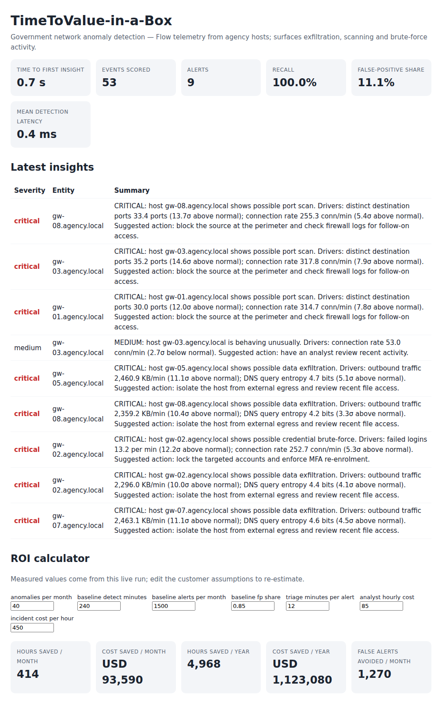

# TimeToValue-in-a-Box: Forward-Deployed AI Prototype Kit

> **Cluster to first insight in minutes.** `make up` times itself and prints the exact figure (N minutes) for your machine; the in-process demo reaches its first insight in under a second.



*Dashboard and ROI calculator (network-anomaly pack, `make demo`).* Customer-facing write-up: [docs/executive-narrative.md](docs/executive-narrative.md).

**One command stands up an event-driven AI pipeline on local Kubernetes for a customer scenario, and tells you how many seconds it took to reach the first working insight.**

`make up` deploys an event bus, an OpenTelemetry collector, a model service, a synthetic data generator and a dashboard to a local [kind](https://kind.sigs.k8s.io/) cluster, starts a stopwatch before the first cluster command, and stops it when the first anomaly insight (score + plain-English summary) comes out the other end. A built-in ROI calculator then converts the *measured* detection speed, recall and false-positive share into hours and money saved.

## Features

- **One-command deploy + time-to-first-insight metric** – `make up` (kind + Docker build + Helm). The stopwatch result is written to `.ttv/last_run.json`, shown on the dashboard and exported as the OTel gauge `ttv.time_to_first_insight`.
- **Two swappable scenario packs** with synthetic generators (`SCENARIO=...`):
  - `network-anomaly` – government network telemetry; exfiltration, port scans, brute force.
  - `predictive-maintenance` – CNC machine telemetry; bearing wear, overheating, rotor imbalance.
- **Model service** (FastAPI): scikit-learn `IsolationForest` scoring, severity, fault diagnosis and a plain-English summary. If `LLM_BASE_URL` points at an OpenAI-compatible server (e.g. Ollama) the summary is LLM-written; on *any* failure, or when unset, a deterministic template summary is used.
- **ROI calculator** – CLI (`make roi`), JSON API and an interactive panel on the dashboard.
- **Automated smoke test** – verifies bus → scoring → summaries → API → dashboard → ROI, in-process (`make smoke-local`) or against the cluster (`make smoke`). GitHub Actions runs unit tests, local smoke for both packs, and a full kind deployment.

## Architecture

```
 generator ──publish──▶ NATS (ttv.events) ──subscribe──▶ model-service ──OTLP/HTTP──▶ OTel collector
 (scenario pack)                                          │  score → summarize          (debug + :8889 Prometheus)
                                                          │  metrics, time-to-first-insight
                                                          ▼
                                   dashboard (HTML + /api/roi) ◀── GET /state
```

| Component | Where | Notes |
|---|---|---|
| Event bus | `deploy/helm/ttv/templates/nats.yaml` | NATS core, `nats-py` client |
| Collector | `otel-collector.yaml` | OTLP in; `debug` and Prometheus exporters out |
| Model service | `ttv/service.py`, `pipeline.py`, `scoring.py`, `summarizer.py` | Endpoints: `/readyz`, `/score`, `/stats`, `/insights`, `/state` |
| Generator | `ttv/generator.py` | Deterministic given `SEED`; labelled ground truth |
| Dashboard / ROI | `ttv/dashboard.py`, `ttv/roi.py` | Polls every 3 s |
| Orchestration | `ttv/kit.py`, `ttv/cli.py`, `Makefile` | kind, docker, helm, stopwatch |
| Scenario packs | `ttv/scenarios/` | Features, fault archetypes, playbooks, ROI assumptions |

All three Python services run from a single image (`ttv:local`) with different commands.

## Setup

Prerequisites for the cluster path: Docker, [kind](https://kind.sigs.k8s.io/docs/user/quick-start/#installation), Helm 3, kubectl, Python 3.10+ and make. The no-cluster path needs only Python and make.

```bash
cp .env.example .env && set -a && . ./.env && set +a   # optional: the app reads plain environment variables (it does not load .env itself); no secrets needed
make install             # venv + dependencies
```

## Run

```bash
# Full stack on kind (SCENARIO=network-anomaly | predictive-maintenance)
make up SCENARIO=predictive-maintenance   # prints "time to first insight: N s"
open http://localhost:8080                # dashboard + ROI calculator
make roi                                  # ROI from the measured run
make smoke                                # end-to-end check against the cluster
make down

# No Docker / Kubernetes: whole pipeline in one process (in-memory bus)
make demo                                 # http://localhost:8090
make smoke-local
```

ROI CLI examples: `python -m ttv.cli roi --detect-seconds 0.5 --recall 0.9 --fp-share 0.1 --anomalies-per-month 60 --json`, or `--url http://localhost:8081` for live numbers. Every customer assumption is a flag.

Optional LLM summaries: `LLM_BASE_URL=http://<host-reachable-from-cluster>:11434/v1 make up` (also `LLM_MODEL`), or export the same variables before `make demo`. Leave unset for deterministic summaries.

## Test

```bash
make test           # 38 unit/integration tests (scoring, summaries, ROI maths, bus, API, in-process smoke)
make smoke-local    # end-to-end smoke without a cluster
```

## Key design decisions

- **NATS over Redpanda** – a ~10 MB single binary that starts in under a second; Kafka semantics (replay, partitions) aren't needed to prove time-to-value. The `Bus` abstraction (`ttv/bus.py`) keeps the transport swappable and enables the in-memory mode used by tests and `make demo`.
- **The stopwatch lives in the product, not in a shell timer.** `make up` passes the start epoch to the model service (`TTV_START_EPOCH`); the service records the instant the first alert is produced. TTV therefore includes cluster creation (cold) or not (warm, cluster already exists) and the result says which.
- **Own Helm chart, no external chart repos** – `make up` needs no network beyond image pulls. Images are built locally and loaded into kind.
- **Deterministic by default.** Seeded generator and a seeded IsolationForest, whose alert threshold is the 99th percentile of baseline scores. The first synthetic anomaly is injected at event 3, so TTV measures the platform rather than luck; later anomalies occur at `ANOMALY_RATE`.
- **Honest ROI model** (`ttv/roi.py`): exposure hours saved = anomalies caught (× measured recall) × (customer's current detection time − measured detection latency), priced per hour of undetected anomaly; triage hours saved = today's false alerts − false alerts implied by the measured false-positive share, priced at analyst cost. Missed anomalies earn nothing; triage savings can go negative. Customer assumptions per pack are illustrative defaults, and all are overridable. Detection latency is measured from generator emit to insight, so it covers bus + scoring + summary but not real-world sensor delay.
- **LLM is optional and can never break the pipeline** – failures, timeouts and empty replies all fall back to the template summary; `summary_source` records which was used.
- **Telemetry is optional** – OTLP export turns on only when `OTEL_EXPORTER_OTLP_ENDPOINT` is set (the chart sets it).
- **Dashboard is a dependency-free HTML page** rather than a Grafana deployment, to keep the kit light and the time-to-value number honest; the collector's Prometheus endpoint (`:8889`) is there if you want to attach Grafana.

## Customer-facing narrative

[docs/executive-narrative.md](docs/executive-narrative.md) is a one-page executive summary in the form a forward-deployed engineer would hand a customer: the question, what was measured, what it is worth in hours and money, the caveats, and a proposed pilot.

## Limitations

- The screenshot and the sub-second figure come from the in-process `make demo`, not from a cluster; the cluster figure is whatever `make up` prints on your machine.
- The kind/Helm path is exercised by the CI `kind-smoke` job; the Helm chart and NATS client path could not be run in the environment this repo was generated in (no Docker access), so treat the first `make up` on your machine as the real verification. Everything else is covered by the tests and the in-process smoke.
- Scoring uses synthetic data only; swapping in real data means adding a scenario pack (see `ttv/scenarios/network_anomaly.py`) and registering it in `ttv/scenarios/__init__.py`.
- Ports 8080/8081 on localhost must be free for `make up`.
